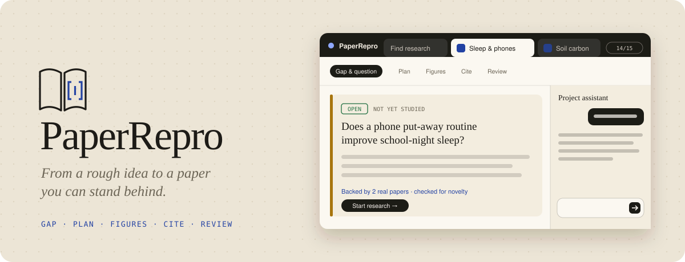
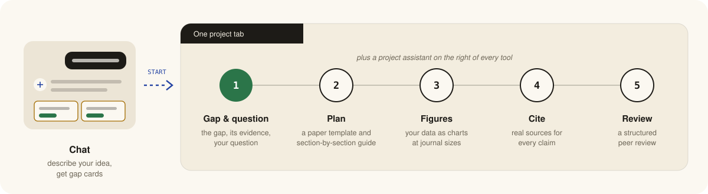
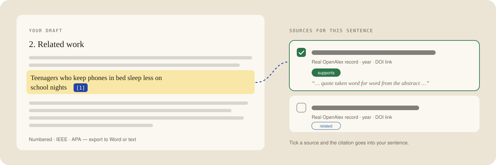
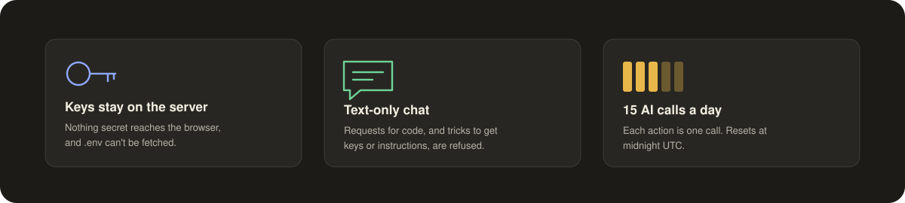

<p align="center">
  
</p>

# PaperRepro

**A research workbench that takes you from a rough idea to a paper you can stand behind.**

You describe what you want to study. PaperRepro searches the published literature, shows you where the open questions are, and then helps you plan the paper, make the figures, cite real sources and get a peer review, all in one place. It runs in your browser, on your own computer.

## How it works

<p align="center">
  
</p>

1. **Chat about your idea.** The home page is a conversation with the Research Guide. Tell it what you're curious about, and it asks what it needs to know. It then searches real papers and shows the **gaps** worth filling as cards: what's missing, which papers show it, and whether anyone has filled it since.
2. **Start research.** Press **Start research** on a gap and it opens as a **project tab**, like a browser tab. You can have several projects open at once, and each tab keeps only its own work.
3. **Work through the five tools** inside the tab:

| | Tool | What it gives you |
|---|---|---|
| 1 | **Gap & question** | The gap, the papers behind it and your research question, kept as the starting point of the project. |
| 2 | **Plan** | A paper template (research article, conference paper, review, short communication, thesis chapter) with a section-by-section writing guide and a Word outline to download. |
| 3 | **Figures** | Paste your data and get line, bar, scatter or error-bar charts at real journal sizes, in colour-blind-safe or grayscale palettes. Export SVG or 300 dpi PNG, with an optional AI-written caption. |
| 4 | **Cite** | Upload your draft. Each sentence that needs a source gets real papers that back it. Tick one, and the citation goes into your text in Numbered, IEEE or APA style. Export to Word or plain text. |
| 5 | **Review** | A structured peer review: six scored criteria, strengths, and issues tied to exact sentences with concrete fixes. |

Every tool also has a **project assistant** on the right: a chat that knows this project and helps you think through the question, the method, the results and the writing, in plain words.

<p align="center">
  
</p>

## Honest by design

PaperRepro is built so the AI can judge sources but never make them up. These rules are enforced in code, not just in prompts:

- **No invented papers.** Every paper shown is a real record from the OpenAlex scholarly database, with a link. Anything the AI mentions that it wasn't shown is dropped.
- **No invented quotes.** A source is only marked "supports" when a quote copied word for word from its abstract backs your sentence.
- **Gaps need evidence.** A gap must point at the papers that show it, and calling a gap "already filled" means naming the paper that filled it.
- **Citations are made by code.** Reference lists and citation markers come from fixed formatting rules, never from the AI.

Everything the AI writes is its reading of abstracts or of your draft, so check it before you rely on it.

## Safe to run

<p align="center">
  
</p>

- **Your keys stay on the server.** API keys live only in a local `.env` file that git ignores. The browser never receives them, every response is checked for anything that looks like a key, and `.env` can't be downloaded through the app.
- **The chat is text only.** Requests for code, and attempts to get the app's keys or instructions, are refused before any AI is called. A reply that contains code is blocked.
- **15 AI calls per user per day.** Each AI action uses one call, whether it's a chat message (including any literature search it runs), a citation run, a review or a caption. The count resets at midnight UTC, and refused messages don't count.
- **Local only.** The app only accepts connections from your own computer and refuses requests from other websites.

## Get started

You need Python 3.10 or newer and [uv](https://docs.astral.sh/uv/).

```bash
git clone https://github.com/OmKadam16/PaperRepro.git
cd PaperRepro
uv venv && source .venv/bin/activate
uv pip install -e ".[pdf,openai]"
```

Create a file called `.env` in the project folder with your keys:

```bash
OPENAI_API_KEY=...        # the AI helpers: gap search, citations, review, captions
OPENROUTER_API_KEY=...    # the project assistant chat
ZAI_API_KEY=...           # backup for the project assistant (optional)
```

Then start the app and open http://127.0.0.1:8765:

```bash
paperrepro serve
```

To process one draft from the terminal instead: `paperrepro cite draft.pdf`.

## Project layout

| Folder | What's inside |
|---|---|
| `src/paperrepro/` | The app: the web server, the research pipelines, and the safety checks (`guard.py`, `quota.py`, `keys.py`) |
| `src/paperrepro/web/` | The browser interface: plain HTML, CSS and JavaScript, with no build step |
| `agents/` | One instruction file per AI helper. Change a helper's behaviour there. |
| `projects/` | Your research, saved on your computer (not in git) |

For how the pieces fit together, see [ARCHITECTURE.md](ARCHITECTURE.md).
